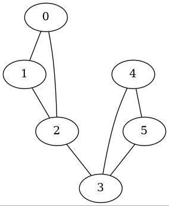

#+TITLE: Org Babel support for Macaulay2

[[https://github.com/d-torrance/ob-M2/actions/workflows/check.yml][file:https://github.com/d-torrance/ob-M2/actions/workflows/check.yml/badge.svg]]

This package adds support for working with [[https://macaulay2.com/][Macaulay2]] source code in [[https://orgmode.org/][Org Mode]].

#+BEGIN_SRC org
  ,#+BEGIN_SRC M2
     R = QQ[x, y, z, w]
     monomialCurveIdeal(R, {1, 2, 3})
  ,#+END_SRC

  #+RESULTS:
  :         2                    2
  : ideal (z  - y*w, y*z - x*w, y  - x*z)
#+END_SRC

* Installation
** Requirements
- [[https://orgmode.org/][Org Mode]]
- [[https://macaulay2.com][Macaulay2]]
- [[https://github.com/Macaulay2/M2-emacs][M2-emacs]]

** Installing
There are several options for installing ob-M2:

*** Macaulay2 package archive
ob-M2 is available from the [[https://macaulay2.com/Repositories/Emacs/][Macaulay2 Emacs package archive]], which also
provides M2-emacs.  Add the following to your =.emacs= or =init.el=:

#+BEGIN_SRC elisp
  (require 'package)
  (add-to-list 'package-archives
               '("M2" . "https://macaulay2.com/Repositories/Emacs/") t)
  (package-initialize)
#+END_SRC

Then run =M-x package-refresh-contents= followed by
=M-x package-install RET ob-M2 RET=.  M2-emacs will be installed
automatically as a dependency.

*** git
In Emacs 29 or later, with the Macaulay2 package archive configured as
above so that M2-emacs can be installed as a dependency:

#+BEGIN_SRC elisp
  (package-vc-install "https://github.com/d-torrance/ob-M2")
#+END_SRC

*** [[https://github.com/quelpa/quelpa][Quelpa]]
#+BEGIN_SRC elisp
  (quelpa '(ob-M2 :repo "d-torrance/ob-M2" :fetcher github))
#+END_SRC

*** [[https://github.com/radian-software/straight.el][straight.el]]
#+BEGIN_SRC elisp
  (straight-use-package '(ob-M2 :type git :host github :repo "d-torrance/ob-M2"))
#+END_SRC

** Activating
Add the following to your =.emacs= or =init.el=.  The =...= indicates any other pairs of the form =(<lang> . t)= specifying languages you wish to load.

#+BEGIN_SRC elisp
  (org-babel-do-load-languages
   'org-babel-load-languages
   '((M2 . t)
     ...))
#+END_SRC

** Using

*** Quick start
Open a file with the =.org= file extension in Emacs and type =C-c C-, s M2= to
begin a new Macaulay2 source code block.  Then start coding!  Type =C-c C-c=
to evaluate.

For complete documentation, see the [[https://orgmode.org/manual/Working-with-Source-Code.html][Working with Source Code]] section of the
Org Mode manual.

*** Graphics
To generate graphics, specify the =file= type and =graphics= format along
with a =:file= header argument.  Then in your Macaulay2 code, call [[https://macaulay2.com/doc/Macaulay2/share/doc/Macaulay2/Macaulay2Doc/html/_show.html][show]] (or
a function that calls it like [[https://macaulay2.com/doc/Macaulay2/share/doc/Macaulay2/Graphs/html/_display__Graph.html][displayGraph]]).  The resulting image will be
generated with the desired filename.  Note that the =convert= utility from
[[https://imagemagick.org/][ImageMagick]] must be present for this to work.

#+BEGIN_SRC org
  ,#+BEGIN_SRC M2 :results file graphics :file barbell.png
    needsPackage "Graphs"
    displayGraph barbellGraph 3
  ,#+END_SRC

  ,#+RESULTS
  
#+END_SRC

Initially, a link to the image file will appear, but it may be
displayed in the buffer by calling =M-x org-toggle-inline-images=.

